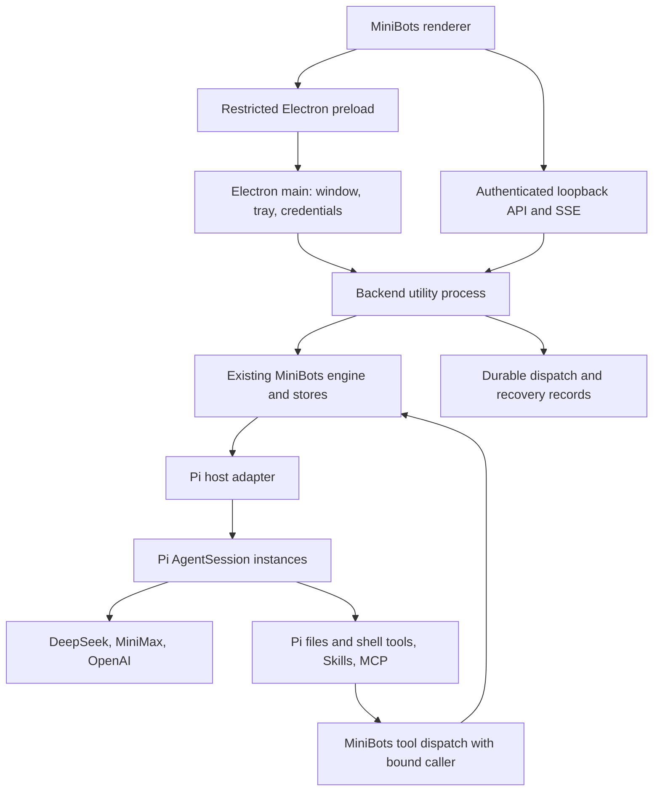

# MiniBots for Windows: end-to-end implementation plan

Status: ready for implementation, subject to the executable integration checks in milestone 1.

Prepared: 2026-11-01, Asia/Shanghai.

This document specifies a proposed implementation. A stated requirement is not evidence that the application already implements it. Record actual evidence in [ACCEPTANCE.md](ACCEPTANCE.md).

## 1. Product contract and settled decisions

Build a personal Windows desktop app that reproduces all features and concepts of the pinned MiniMax Bot plugin. Use its existing layout, artwork, chat behavior, and local business logic as the starting point.

The user has selected:

| Area | Required behavior |
|---|---|
| Platform | Standalone Windows desktop app. MiniMax Code is not required. |
| Feature scope | Full feature parity with the source baseline, rather than a chat-only subset. |
| Runtime | Existing open-source Pi coding-agent SDK. Do not implement a new model/tool loop. |
| Providers | User-owned DeepSeek, MiniMax, and OpenAI API keys. |
| Model selection | Provider, model, and supported reasoning setting selectable per bot. |
| Autonomy | Full autonomy by default, with visible activity and stop controls. |
| Lifecycle | Start at Windows sign-in. Closing the window hides it to the tray. Explicit Quit stops the app. |
| Missed schedules | Run each overdue schedule once after downtime. Combine multiple missed occurrences of that schedule into one catch-up run. |
| Interface | Preserve the existing layout, bot appearances, and chat interactions initially. |
| Conversation state | Preserve private conversations, separate group sessions, per-bot memory, and team memory. |

Implementation defaults chosen for this plan: Windows x64 first; Electron desktop shell; Node backend in an Electron utility process; new integration modules in TypeScript; existing plugin JavaScript retained; npm lockfile; electron-builder NSIS per-user installer. These defaults are implementation choices, not additional user requests.

A native Windows process is the default execution environment. Do not introduce Docker, WSL, a cloud backend, a login service, or a required Pi CLI installation. The app must bundle its runtime dependencies. Git Bash may be a documented tool prerequisite if the selected Pi tools require it; PowerShell must work on a standard Windows machine.

## 2. Sources, versions, and evidence boundaries

### 2.1 MiniBots baseline

- Repository: <https://github.com/MiniMax-AI/MiniMax-Code-MiniApps>
- Commit inspected: `79ebc4b89be6b372365199db92d69e5e36ac3409`.
- Subtree: `plugins/minimax-ai/minimax-bot`.
- Package version: `0.7.16`.
- License file: `plugins/minimax-ai/minimax-bot/LICENSE`, MIT with MiniMax attribution.
- A research checkout was created at `C:\Users\book\AppData\Local\Temp\minibots-upstream-20261101`. It is a convenience, not a required build input.

Import the complete subtree, including dotfiles, assets, and tests. Record the commit, package version, source URL, import date, and license in `vendor/minimax-bot/UPSTREAM.md`. Keep original license notices. Use the commit above as the acceptance baseline even if upstream changes during implementation.

### 2.2 Pi baseline

- Repository: <https://github.com/earendil-works/pi>, redirected from `badlogic/pi-mono`.
- Repository HEAD observed during research: `2c8d1feb147f6b3d97e855da803bfe7b19f3c403`.
- Published package verified with npm: `@earendil-works/pi-coding-agent@1.4.0`.
- Package engine requirement: Node `>=22.19.0`.
- Pin the package exactly, with matching direct Pi dependencies when needed and a committed lockfile.
- The repository HEAD and npm tarball are distinct artifacts. Verify the installed package's exports and types. Do not assume the HEAD exactly represents the published tarball.

Primary references:

1. [Pi SDK](https://github.com/earendil-works/pi/blob/main/packages/coding-agent/docs/sdk.md).
2. [Pi full-control example](https://github.com/earendil-works/pi/blob/main/packages/coding-agent/examples/sdk/12-full-control.ts).
3. [Pi MCP example](https://github.com/earendil-works/pi/blob/main/packages/coding-agent/examples/sdk/14-codemode-mcp.ts).
4. [Pi provider configuration](https://github.com/earendil-works/pi/blob/main/packages/coding-agent/docs/providers.md).
5. [Pi Windows behavior](https://github.com/earendil-works/pi/blob/main/packages/coding-agent/docs/windows.md).
6. [Pi session format](https://github.com/earendil-works/pi/blob/main/packages/coding-agent/docs/session-format.md).
7. [Electron utility processes](https://www.electronjs.org/docs/latest/api/utility-process).
8. [Electron safeStorage](https://www.electronjs.org/docs/latest/api/safe-storage).

The current SDK documents persistent sessions, configurable model/resources, events, cancellation, and MCP extension setup. Translate these capabilities through a tested adapter. This plan intentionally does not invent exact SDK overloads that have not been checked against the installed 1.4.0 declarations.

### 2.3 Dependency verification gate

Before product implementation:

1. Resolve and pin an Electron release whose embedded Node meets Pi's engine requirement.
2. Pin TypeScript, build tools, electron-builder, and the test runner.
3. Import Pi in an Electron utility process, including its runtime assets and native dependencies.
4. Verify persistent sessions, cancellation, model selection, and MCP integration against the installed package.
5. Record exact versions, exports used, and observed events in `docs/runtime-validation.md`.
6. If a documented export is absent, inspect the tarball and use a supported equivalent. Record the correction. If a required capability is impossible, report that concrete blocker before changing runtimes.

## 3. Architecture and ownership



| Component | Owns | Must not own |
|---|---|---|
| Electron main | Single-instance lock, window/tray, startup registration, secret encryption, backend process supervision | Model loops, conversation policy |
| Renderer | Existing views, settings input, progress display, previews, session inspector | Raw provider credentials, arbitrary shell execution APIs |
| Backend | Existing HTTP/SSE API, orchestration, schedule/job state, authenticated request boundaries | A replacement LLM loop |
| MiniBots engine | Chief/team rules, group routing, handoffs, memory selection, helper admission | Provider protocol translation |
| Pi adapter | Session association, event translation, model selection, cancellation, question/permission integration | Reimplementing Pi retries, compaction, or tool loop |
| Pi | Model conversation history, model calls, tool loop, context compaction, tool execution | Group membership or schedule ownership |
| Credential service | Encrypted keys at rest, in-memory transfer to runtime | Keys in bot prompts, logs, or renderer snapshots |

Use one backend writer for application state. Pi owns its session files. Do not let the renderer, Electron main, and backend write the same settings or message file.

Keep MiniBots' orchestration instead of adding a second agent framework. A helper is an independent Pi session admitted by the existing helper queue. A bot in a group uses its own group-specific session. Chief is an ordinary Pi-powered bot with special MiniBots management capabilities.

### 3.1 Proposed repository structure

```text
README.md
package.json
package-lock.json
tsconfig.json
electron-builder.yml
vendor/minimax-bot/
  UPSTREAM.md
  LICENSE
  miniapp/client/                 # Existing UI, modified narrowly
  miniapp/node/                   # Existing engine, HTTP server and stores
  tests/                         # Imported upstream tests
src/desktop/
  main.ts
  preload.ts
  backend-process.ts
  credentials.ts
  startup.ts
src/backend/
  entry.ts
  desktop-context.ts
  auth.ts
  settings.ts
  recovery.ts
src/runtime/
  pi-adapter.ts
  session-registry.ts
  event-mapper.ts
  model-catalog.ts
  resource-loader.ts
  bot-tools.ts
  interactions.ts
src/storage/
  atomic-json.ts
  dispatch-ledger.ts
  migrations.ts
src/shared/
  desktop-contract.ts
  runtime-contract.ts
tests/{runtime,integration,desktop,fixtures}/
scripts/{dev,build,verify-upstream,smoke-runtime,verify-package}.mjs
docs/{IMPLEMENTATION_PLAN,ACCEPTANCE,runtime-validation,operations}.md
```

These are proposed paths. Combine small modules when a wrapper adds no ownership or invariant. Keep the responsibility boundaries above.

## 4. Preserve and adapt the source

### 4.1 Source map

| Source | Existing responsibility | Planned work |
|---|---|---|
| `miniapp/node/server.mjs` | `start(context)`, HTTP routes, static UI, SSE, media | Supply a local context, add authenticated loopback access, expose actual ephemeral port, clean shutdown |
| `engine.mjs` | Turns, groups, helpers, schedules, model lookup | Replace injected agent implementation; fix event correlation; route schedule admission through durable records |
| `store.mjs` | State and message storage | Preserve formats; add versioned migrations and recovery association |
| `team.mjs` | Bot/group management | Preserve Chief rules and schema validation |
| `mcp.mjs` | MiniBots tool schemas and dispatch | Extract reusable handlers; bind runtime caller identity |
| `task-dispatcher.mjs` | Task dependencies and delivery | Preserve DAG and result semantics; add recovery evidence |
| `memory*.mjs` | Memory persistence, context selection, revision checks | Preserve semantics and limits |
| `relay-guard.mjs`, `group-note.mjs` | Relay control and group context | Preserve protocol sanitization and convergence behavior |
| `client/core.js` | Shared UI and host session opening | Replace host bridge with narrow desktop bridge |
| `client/app.js`, `panels.js` | Chat and settings flows | Add providers, Windows options, session inspector |
| Client strings and i18n files | English/Chinese interface | Add every new user-facing string in both languages |

Run the original tests before modifications. Keep a baseline report. Do not rewrite the frontend into React or replace storage wholesale as part of the port.

### 4.2 All host dependencies

Search the complete imported subtree for `context.`, `window`, host bridge access, MiniMax session opening, model catalogs, and environment assumptions. Record every dependency in `docs/runtime-validation.md` with its replacement and test. The list must cover `pluginRoot`, `dataDir`, `listen`, `signal`, `logger`, `agent`, and any actual `hostConnector` use.

The checked-in `miniapp-api.ts` describes `run`, `answer`, and `reply`, but the engine also calls `models()` and passes model selection to `run`. Define a local contract that matches real call sites. Do not preserve unchecked `any` casts as the integration design.

## 5. Pi adapter contract

### 5.1 Public operations

Implement a MiniBots-facing facade with these operations. Exact TypeScript declarations must follow the imported call sites and installed Pi types.

| Operation | Required semantics |
|---|---|
| `run(input, options)` | Accept text, optional existing session ID, resolved provider/model/effort, immutable run identity, and cancellation signal. Stream compatible events and resolve a terminal result. |
| `models()` | Return the catalog and default in the shape consumed by `Engine.modelCatalog`, `modelKey`, and `withEffort`. |
| `answer(input, options)` | Validate and consume a pending questionnaire answer exactly once, then run the continuation. |
| `reply(input)` | Resolve a pending approval exactly once when optional approval mode is enabled. Full autonomy generates no routine approval prompts. |
| Session inspection | Return normalized messages, tool calls, state, and errors for the replacement session viewer. |
| `dispose()` | Stop admission, abort active sessions, close MCP clients, flush owned state, and release handles. |

Use separate identifiers for bot, chat, application session, Pi session file, run, model message, tool call, and request. Never use a bot name as an identifier. Persist app-session-to-Pi-file associations before acknowledging turn acceptance.

### 5.2 Session identity and ownership

- A private conversation has a distinct session per bot and conversation generation.
- A group has a distinct session per group, bot, and conversation generation.
- Each helper has a fresh session. Link its result to its parent run and chat.
- Clearing a chat increments the generation and prevents old completion events from entering the new chat. Keep group notes according to original semantics.
- One active prompt owns a Pi session. Serialize its follow-up messages through the existing inbox. Different sessions can run concurrently.
- Configure explicit `cwd`, agent directory, settings, and resource discovery. Never call `process.chdir()` to switch between concurrently running bots.
- Default work directory: the user's `Documents\MiniBots\Workspace`. Create it once. Expose a configurable default workspace in settings. Full autonomy permits access beyond it.
- Reopen sessions through Pi's session manager. Do not reconstruct provider history from displayed chat bubbles or directly assign Pi internal message arrays.
- Snapshot the selected model and bot configuration at run admission. Changes affect the next run. Do not alter an active run's provider halfway through a tool sequence.

### 5.3 Event translation

The following describes required behavior. Verify the exact discriminants and payload fields in the pinned Pi release.

| Pi occurrence | MiniBots event or record | Invariant |
|---|---|---|
| Run admitted, session persisted, prompt about to start | `turn.started` | Emit once per application run. Establish IDs before any tool callback. |
| Assistant text delta | `text.delta` | Emit only visible answer text. Keep reasoning blocks distinct. |
| Completed assistant message | `message.committed` | Reconcile streamed text by message ID. Do not append a duplicate copy. |
| Tool execution start | `tool.started` | Include stable `toolCallId` and bound run context. |
| Tool execution end | `tool.finished` | Match by ID, not name. Parallel calls to the same tool remain distinguishable. |
| Pi fully settled and prompt completed | `turn.finished` plus result | Exactly one terminal record; inspect errors and pending interaction state before reporting success. |
| Confirmed cancellation | Aborted result | Stop future deltas; retain completed tool evidence. |
| Failure after dispatch with uncertain effects | Unknown-outcome error | Never report success or automatically repeat side effects. |

The original engine matches tool results by name and applies text-prefix heuristics. Add optional message/tool IDs to the local event contract, migrate engine consumers, and retain compatibility with existing test fixtures where appropriate. Tests must include identical text in different messages and simultaneous calls to the same tool.

Do not interpret a low-level `agent_end` as proof that retries and follow-ups have finished. Use the settled behavior documented by the installed SDK, together with completion of the submitted prompt. Disconnect subscriptions when sessions are replaced or disposed.

### 5.4 Failure and retry ownership

Pi owns model-request retry and context compaction. Configure bounded retries using its supported settings. MiniBots owns queue admission, user-visible task state, and recovery.

Review the existing engine's retry loop to prevent multiplying retries at both layers. A validation or authentication failure is terminal until configuration changes. A transient model request can be retried by Pi. A whole application turn must not be replayed automatically after any tool has started or after an uncertain outcome.

Normalize errors into: configuration, authentication, quota/rate limit, context, provider unavailable, tool failure, cancellation, missing session, busy session, and unknown outcome. Keep provider diagnostics in redacted logs. Show a concise actionable error in the chat. Preserve partially completed tool history.

### 5.5 Questions and permissions

Preserve the questionnaire and approval interfaces. Full autonomy removes routine execution approvals, not requests for missing information.

Implement an `ask_user` integration tool using a Pi extension or custom tool. Persist the request, schema, owning session, and run. Return the original MiniBots pending-question structure. End or suspend the current turn using a verified SDK mechanism, without consuming a background slot indefinitely. On answer, validate option IDs and text, mark it consumed atomically, and continue the same session through a fresh run. Never fabricate a provider tool-result message that does not match Pi's stored tool-call history.

Milestone 1 must prove the pause/resume mechanism. A supported fallback is a tool result stating that input is pending, followed by a controlled run stop and a later user-answer message in the same session. Confirm the stop occurs before unrelated tool actions. Record the chosen behavior and crash test it.

Keep an optional Ask-before-actions setting for original approval parity. Default it to Full autonomy. Approval requests in that mode must survive UI reconnects; stale requests reject without dispatching a tool.

## 6. Providers and credential flow

Use Pi's provider implementations for DeepSeek, MiniMax, and OpenAI. Do not write new streaming parsers or provider tool-call loops.

Add a Providers settings page with provider name, region/endpoint where applicable, password-style API-key input, Save, Remove, Test connection, and status. Offer MiniMax global and China endpoints explicitly because their keys are not interchangeable. Allow advanced base-URL configuration using supported Pi configuration. Validate URL syntax and show the effective endpoint.

Use a default provider/model for bots that follow defaults. Preserve per-bot overrides. Populate models from Pi's catalog, filtered to configured providers, with a manual model-ID option. Validate capability metadata, including input types, tool calling, context limits, and reasoning levels. Do not present identical effort choices for all models. Never silently switch providers after an error.

Credential path:

1. Renderer submits a key through a dedicated preload method.
2. Electron main encrypts it with available OS-backed safeStorage APIs and stores only encrypted bytes.
3. Main sends the resolved credential to the backend over private IPC when needed.
4. Backend supplies the key through Pi's in-memory runtime credential API. Verify that normal execution does not create plaintext Pi auth files.
5. Save/remove invalidates credential caches for future runs. Do not mutate running sessions silently.

Keep provider secrets out of generic HTTP settings, snapshots, SSE events, logs, URLs, process arguments, and exports. Restrict preload callers to the main app frame. This protects application boundaries; full-autonomy code running as the same Windows user is not an OS isolation boundary.

Connection testing uses a small explicit API request and reports authentication separately from model access. Do not trigger repeated billable tests on settings render. Real-provider tests require configured credentials. Missing credentials must appear as untested, not passed.

## 7. Tools, Skills, MCP, and authority

### 7.1 PC tools

Use Pi's existing read, write, edit, search, and shell capabilities. Enable its native PowerShell tool on Windows. Detect Git Bash if enabling Bash. Show missing optional prerequisites in settings and keep supported tools usable. Do not assume a Unix shell exists on a clean PC.

Pass absolute paths through structured tool arguments. Test spaces, Unicode, drive letters, UNC paths, and long output. Keep tool execution in the backend. Use hidden windows for command processes. Cancellation must terminate owned subprocess trees where supported; report processes that could not be stopped as unknown or still running.

Preserve file attachments as local uploaded artifacts. Pass images to vision-capable models through Pi's supported input representation. Text-only models must not claim to have seen an image. Preserve file paths for tool-based inspection. Unsupported binary formats remain attachments, with an explicit inability to inspect them when necessary.

### 7.2 MiniBots business tools

Preserve these tools and their original schema/role rules:

`list_team`, `message_bot`, `dispatch_tasks`, `get_tasks`, `cancel_tasks`, `post_group`, `start_helper`, `list_helpers`, `stop_helper`, `remember`, `forget`, `recall`, `create_bot`, `update_bot`, `delete_bot`, `create_group`, `update_group`, `delete_group`, `create_schedule`, `list_schedules`, `delete_schedule`.

Extract schemas and handlers from the existing MCP module into a shared dispatch layer. Register them as Pi custom tools using session-bound closures. Keep the Streamable HTTP MCP endpoint as another transport over those same handlers. Avoid duplicated implementations.

Bind `botId`, `chatId`, `sessionId`, `runId`, and helper ancestry from the active runtime context. Validate or replace model-supplied caller fields. A model must not gain Chief privileges by writing another bot ID in its arguments. Preserve the UI's canonical `mcp__minimax-bot__...` labels where engine receipt logic depends on them, even if Pi uses another wire name.

Preserve immediate admission receipts for delegation and later delivery of completed results. Never hold an execution slot while synchronously waiting for a delegated bot that needs that slot. Parent and child error/cancellation records must remain attributable.

For the HTTP MCP transport, issue scoped caller credentials with server-side identity association. Test a cross-session impersonation attempt. Enable the transport when configured; do not expose an unauthenticated local endpoint by default.

### 7.3 External MCP and Skills

Expose local stdio and remote Streamable HTTP MCP configuration. Reuse Pi's MCP extension. The SDK does not automatically configure all CLI extensions; follow the installed release's extension setup, bind lifecycle callbacks, and wait for tool discovery readiness before declaring the integration usable.

Use one app-owned resource directory and explicit workspace discovery. Support SKILL.md discovery and instructions without importing unrelated global Pi settings by accident. Display discovered Skills and MCP status. New configuration applies to idle/new sessions; reload active resources at a safe run boundary.

Test local and remote MCP calls, connection failure, reconnect, cancellation, and resource access. If authentication requires browser/device flows, expose the supported Pi flow through the app and preserve its credentials separately. Never imply that built-in media rendering provides an image/video generation service; those capabilities require configured tools.

## 8. Data model, storage, and migrations

Store application data below Electron's per-user data directory. Product name and application ID must remain stable after the first release. The logical layout is:

```text
userData/
  settings.json
  credentials.enc.json
  schema-version.json
  bot-data/                 # Original state/messages/memory/uploads/avatars/usage
  runtime/
    sessions.json           # App IDs to Pi session locations and ownership
    pi-sessions/            # Pi-owned conversation files
    dispatch.json          # Admission, schedules, jobs, delivery and interactions
    resources/             # App-controlled Pi configuration and Skills/MCP
  logs/
  backups/
```

Keep original message and memory formats. Use versioned, validated JSON records for new app-owned state. Write complete records through temporary files and atomic replacement in the same directory. Serialize writes per owner. Test Windows file-lock failures with bounded retries. Keep the last valid snapshot and a recoverable backup rather than overwriting corrupted data.

The initial dispatch ledger can be one atomic JSON document because this is a personal app with bounded queues. Do not invent cross-file atomicity. Keep a schedule's claim, its next due time, and its queued delivery in the same dispatch transaction. Treat the old schedule representation as a migrated/projection format with one authoritative owner.

Required persisted records:

| Record | Required fields and invariants |
|---|---|
| Session association | App ID, bot ID, chat ID, generation, Pi file, creation/update time, workspace. One writer per Pi session. |
| Run | Run ID, session ID, origin, immutable provider/model, status, admission/start/end time, last event sequence, error, side-effects-started flag. |
| Job | Job ID, parent/source IDs, dependency IDs, queue state, run association, result-delivery state. |
| Schedule | ID, target bot, prompt, kind, timezone, rule, next due time, enabled state. |
| Schedule delivery | Unique delivery ID, schedule ID, due-through time, claimed time, dispatch state, run ID. |
| Pending interaction | Request ID, session/run, question or permission schema, status, answer/decision, consumed time. |

Use tagged states, not loosely related booleans. Run states include queued, running, waiting-for-input, finished, failed, aborted, and interrupted/unknown. A finished run cannot later become running. A retry or continuation gets a new run ID linked to its predecessor.

Maintain a durable application event sequence per run. On SSE reconnect, refresh authoritative snapshots and running state; if replay is offered, deduplicate by run ID plus sequence. A disconnected renderer must not cancel a run.

Migration procedure: obtain the backend lock, validate the old version, create a backup, transform into new files, validate, atomically publish the schema version, and only then admit work. Unsupported future schemas produce a recovery screen. Do not silently reset data. Export/import should include bot data and sessions, with credentials excluded by default.

## 9. Scheduling, concurrency, and recovery

### 9.1 Scheduling rules

Retain daily, interval, and once schedules. Store UTC instants for due times. Store an explicit IANA timezone for daily schedules; default to the user's OS timezone when creating one. Existing schedules migrate using the machine timezone at migration. Display that timezone in settings.

Daily schedules fire once per local date. For a nonexistent DST time, fire at the next valid local time. For a repeated DST time, fire on the first occurrence only. Interval schedules keep an anchor so missed runs do not cause rapid backlogs. Preserve original minimum interval constraints.

On startup, resume, and periodic timer ticks:

1. Acquire the scheduler transaction lock.
2. Find enabled schedules with `nextDueAt <= now`.
3. For each schedule without an outstanding delivery, create one durable catch-up delivery and advance its next due time beyond now in the same transaction.
4. Coalesce repeated overdue occurrences into that delivery. Preserve the original prompt and target snapshot.
5. Admit the queued delivery into the bot inbox with a stable delivery ID.
6. Persist run association before treating it as dispatched.
7. Disable a once schedule after durable delivery creation; retain enough history to prevent replay.

If the bot is busy, the delivery remains queued. Never drop it because the scheduling timer advanced. Repeated ticks must find the existing delivery and do nothing. Disabled/deleted targets receive an explicit cancelled or failed state.

### 9.2 Concurrency and helper behavior

Preserve the original helper limits: at most two running helpers, at most four queued/running helpers per bot, and chat capacity reserved separately. Audit the source to preserve its actual foreground admission rules. Sessions remain single-writer even if their bots have several chats.

Retain task dependencies, cancellation propagation, immediate receipts, and delayed result routing. Deliver each helper result once by durable delivery ID. Deleting a bot cancels its queued work and stops its owned runs before deleting associations. Clearing a chat must not cause completion messages to reappear there.

### 9.3 Crash and restart behavior

After a crash, distinguish never-started queued work from work that may have executed tools. Resume queued admissions automatically. Mark previously running work interrupted unless Pi's persisted evidence proves a terminal result. Do not automatically replay uncertain side effects.

The user's catch-up requirement guarantees one admitted catch-up delivery per schedule after missed downtime. It cannot guarantee exactly-once external actions across a crash. If a schedule was running when the process died, show its uncertain outcome and retain the transcript. Do not disguise it as an unstarted missed occurrence.

Use stable IDs and reconciliation across the ledger and MiniBots messages to avoid duplicate schedule bubbles or helper reports after a crash between file writes. Injection tests must terminate the process before and after each admission/delivery persistence boundary.

## 10. Windows desktop and local API

### 10.1 Startup and process lifecycle

Electron main acquires a single-instance lock, initializes credential storage, starts the utility backend, and waits for its authenticated readiness message. The backend binds `127.0.0.1` on port 0 and reports its assigned port. Main then loads `/bot` in the renderer.

Retain the existing same-origin HTTP/SSE interface to minimize UI changes. Use a per-launch random credential installed as an HttpOnly same-site session cookie in the Electron session. Validate Host/Origin for relevant requests and authenticate every application API/media route. Authenticate the MCP transport with separate scoped credentials. Do not rely on loopback binding alone.

Disable renderer Node integration. Enable context isolation and sandboxing. Expose only typed preload methods for credential operations, native dialogs, session opening, and desktop preferences. Do not expose generic IPC, arbitrary file reads, or `exec` to web content. Keep HTML previews isolated from the privileged app frame.

Closing the main window hides it. Tray actions: Open MiniBots, Stop all work, Settings, and Quit. Start-at-sign-in is enabled for the installed app as agreed, with a visible toggle. Do not modify the developer's startup registration merely by running a development build. Quit stops admission, cancels owned runs, flushes state, closes MCP and HTTP handles, and exits. Use a bounded shutdown deadline, then record uncertain work for recovery.

Handle suspend/resume through Electron power events. On resume, re-establish connections and run the scheduler reconciliation. Do not prevent sleep by default. Restart a crashed backend with bounded backoff; keep the window open with a recovery state after repeated failures.

### 10.2 Replacement session inspector

Replace `host()?.miniapp?.agent?.open(sessionId)` with an app-owned inspector. It must show assistant messages, tool input/output with sensible truncation, status, timestamps, provider/model, pending questions/approvals, and stop controls. Include helpers and child-session links. Long output can be opened separately. Use the app's session association, not a path supplied by the renderer.

### 10.3 New settings and endpoints

Preserve existing routes and payload shapes. Add versioned DTOs for these proposed endpoints; names may be adjusted to existing conventions in one coordinated change:

| Operation | Proposed boundary |
|---|---|
| Read/write nonsecret desktop preferences | `GET/PATCH /api/desktop/settings` |
| List provider configuration and status | `GET /api/providers` |
| Set/remove provider key | Dedicated preload IPC; never generic HTTP settings |
| Test provider/model access | `POST /api/providers/:id/test` |
| Read session transcript | `GET /api/runtime/sessions/:id` |
| Read run state | `GET /api/runtime/runs/:id` |
| Stop run or all runs | `POST /api/runtime/runs/:id/stop`, `POST /api/runtime/stop-all` |
| Answer pending interaction | Existing answer/approval route adapted to durable request IDs |
| List/reload Skills and MCP status | Authenticated resources endpoints |

Validate request bodies at these boundaries. Return structured error code, user message, and request ID. Keep secrets and raw provider headers out of responses.

## 11. Feature parity requirements

Every row below must have a source reference, implementation location, automated test where meaningful, and manual installed-app evidence in the acceptance report.

| Feature family | Required coverage |
|---|---|
| First launch | Chief greeting, setup guidance, persistent bot creation. Prompt for provider configuration if no usable key exists. |
| Bot settings | Name, role, instructions, model/effort, appearance, helper preference, edit/delete. |
| Direct chats | Streaming, queued input, history, clear chat, stop, attachments, reply actions. |
| Groups | Admin/all reply modes, member management, mentions including Unicode boundaries, PASS, relay limits, natural convergence, separate sessions. |
| Group notes | Optional bounded notes, context injection, survive clearing messages, removal with group. |
| Bot handoffs | Immediate admission receipts, completed result return, errors, correct originating chat. |
| Posting groups | Private-chat-only `post_group`; Chief exception for membership; group-origin rejection. |
| Helpers/tasks | Queue, dependencies, original caps, progress folding, cancellation, result review, latest 30 completed records. |
| Memory | Per-bot/team scopes, explicit long-term facts, pinned/relevance selection, revision conflicts, journal, limits and sanitization. |
| Schedules | UI and tool CRUD, once/interval/daily, per-bot display, catch-up, busy-target behavior. |
| Files/media | Attachments, image/audio/video/file cards, local HTML and Markdown previews, downloads, retry, original size policies. |
| Appearance | All 11 shipped looks, bot/mention colors, avatar import/crop/deduplication, reusable avatar library, themes. |
| Reactions | Quick and searchable emoji, one reaction per message, persistence, no model turn triggered. |
| Navigation | All/unread/group/direct filters, unread counts, restored selection, tasks view. |
| Reply controls | Copy, quote, reaction, session viewer at the original positions, correct multi-message bubbles. |
| Usage | Existing turn/character/tool/time statistics and 24-hour/7/30/90-day views. Optional token data never replaces existing counters. |
| Language | English/Chinese auto detection and preference across UI, tools, prompts, errors. Existing user text is preserved. |
| Interactions | Pending questionnaire and optional approval UI, session links, reconnect, expiry. |

Upstream README prose contains historical inconsistencies, including avatar path behavior. Resolve against the pinned implementation and tests. Document the chosen behavior and do not import known invalid path handling from stale prose.

## 12. Implementation milestones and commit sequence

Complete these milestones in order. Commit each major milestone after its checks pass. Use a `codex/` branch. Keep acceptance evidence truthful and update this plan when a verified SDK constraint changes an implementation detail.

### M0. Import and establish the baseline

Deliver: package skeleton, upstream subtree, license/attribution, source manifest, baseline test report, root scripts.

Tasks: inspect repository instructions; import the pinned commit; inventory tests/assets/routes/tools; run the unmodified tests; record pre-existing failures; configure ESM and strict TypeScript for new modules; add a lockfile and ignores for dependencies, build outputs, secrets, and personal app data.

Exit: the original test results are reproducible; all 11 skin assets and the tool inventory are accounted for; no application credentials are present.

### M1. Prove Pi inside the packaged execution environment

Deliver: `scripts/smoke-runtime.mjs`, Pi version/contract report, smallest working utility-process integration.

Tasks: verify package exports and Electron Node version; create independent persistent sessions; register a session-bound tool; stream text/tool events; abort a run; reopen a session; exercise model/effort changes; wire one local and one remote fixture MCP server; prove questionnaire pause/resume; probe Git Bash/PowerShell behavior; verify runtime assets in a packaged smoke build.

Exit: deterministic fixtures prove event and state handling; real configured providers each complete a file task; no credential writes appear in plaintext. If keys are unavailable, finish all other work and explicitly mark the live-provider gate outstanding.

### M2. Bring up the existing app with the desktop host

Deliver: Electron shell, backend bootstrap, local context, authenticated HTTP/SSE, existing UI, first-run provider settings.

Tasks: preserve client static paths; bind an ephemeral loopback port; add readiness and shutdown IPC; implement credential storage; normalize model catalog; connect a private Chief session; replace host session-open calls.

Exit: launch the desktop app, save a key, create a bot, perform a real file task, stop it, restart, and continue the same conversation. Closing/reopening the window does not interrupt the backend.

### M3. Complete collaboration and resource integration

Deliver: all MiniBots business tools on shared dispatch, bound authority, Pi Skills/MCP resources, event IDs, questionnaire and optional approval behavior.

Tasks: exercise Chief create/edit/delete; restore group modes and notes; preserve mention parsing and relay guards; integrate message_bot/post_group; run helpers and dependency tasks; validate memory receipts and revision conflicts; connect file/media output and session inspector.

Exit: three bots using the three selected providers can complete a group task and a delegated helper task. Private content remains absent from group model context. Forged caller fields cannot grant management privileges.

### M4. Add durable scheduling and recovery

Deliver: dispatch ledger, migrations, schedule catch-up, delivery deduplication, restart reconciliation, sleep/resume behavior.

Tasks: implement the atomic admission transitions; migrate existing schedules; implement explicit timezone handling; test busy bots; simulate crashes around queue/run/result boundaries; verify helper failure/cancel propagation; add Stop all work.

Exit: one overdue schedule produces one catch-up delivery, regardless of repeated ticks or restarts. Uncertain tool executions appear as interrupted and are not silently replayed.

### M5. Finish desktop behavior and all UI parity

Deliver: tray, startup registration, full settings, localized strings, original visuals and actions, complete session inspector, diagnostics/export.

Tasks: compare screens to the imported baseline; check all parity rows; test preview isolation and downloads; validate avatar persistence; test unread/filter restoration; keep usage counted once; cover no-key/offline/error states.

Exit: no missing feature is hidden by a disabled or placeholder control. All acceptance rows have evidence or an explicit unresolved blocker.

### M6. Build and validate the Windows release

Deliver: NSIS installer, versioned unpacked build for diagnostics, checksums, operations guide, final acceptance report.

Tasks: package on Windows; unpack native dependencies and Pi assets as required; test installation under paths with spaces; verify no external Node/Pi CLI requirement; test upgrade and uninstall preservation; test startup/tray on the installed artifact; confirm no development server is required.

Exit: the installed app passes the full acceptance checklist on Windows. Report installer location, SHA-256, tested versions, completed checks, and any signing or live-provider limitation.

## 13. Build and test contract

Create the following root commands. These names are planned interfaces, not commands that exist in this planning-only repository yet.

| Command | Required behavior |
|---|---|
| `npm ci` | Reproduce the pinned dependency graph. |
| `npm run dev` | Build/watch integration code and launch Electron using a separate development data directory. |
| `npm run typecheck` | Check new TypeScript and local runtime boundary declarations. |
| `npm run test:upstream` | Execute all imported tests with a runner that expands file globs consistently on Windows. |
| `npm run test:runtime` | Exercise adapter, model selection, events, custom tools, and session persistence. |
| `npm run test:integration` | Run app HTTP/SSE, memory/group/helper, scheduling, and crash tests. |
| `npm run test:desktop` | Exercise Electron UI and lifecycle with a temporary app-data directory. |
| `npm run test:providers` | Explicit opt-in real calls to each configured provider; missing keys produce a non-passing/unverified report. |
| `npm run build` | Compile code and stage all runtime resources without installing startup entries. |
| `npm run dist:win` | Produce the per-user Windows x64 installer and unpacked app. |
| `npm run verify:package` | Inspect and launch the packaged artifact, verify assets/runtime imports, and produce a report. |

Retain upstream test tools. Use Node test runner for compatible new backend tests and a Windows-capable Electron automation tool for UI checks. A deterministic provider fixture can exercise malformed responses, retry, streaming, and tool calls through the real Pi adapter; it must not replace live-provider acceptance.

### 13.1 Mandatory regression cases

- Text streams, commits, and renders once across several assistant messages in one run.
- Same-name concurrent tool calls settle independently by tool-call ID.
- Two sessions using different models do not share credentials, prompts, or mutable working directories.
- A private session and a group session for the same bot remain distinct after restart.
- Clearing a chat while a helper completes cannot insert its stale reply into the new generation.
- Pi compaction preserves a usable session; MiniBots memory selection does not flood every prompt.
- Retry after pre-dispatch network failure succeeds; failure after tool execution does not replay the whole task.
- Questionnaire answer and approval decision reject duplicate submissions, stale IDs, and wrong session ownership.
- MCP disconnects produce tool failures; reconnect restores availability without duplicate business dispatch.
- Schedule catch-up survives repeated startup ticks, busy chats, clock movement, sleep, DST, and interrupted writes.
- Renderer refresh and SSE reconnect do not duplicate unread counts, usage, messages, or terminal events.
- Stop individual/Stop all/Quit act on owned work and preserve completed results.
- HTML previews cannot invoke preload APIs or fetch app data with privileged credentials.
- Keys are absent from exported data, logs, snapshots, command arguments, and ordinary Pi auth files.
- Corrupted/truncated state produces recovery behavior and preserves backups.
- Installed app supports Unicode filenames, long tool output, missing Git Bash, and unavailable providers.

## 14. Packaging and operations

Use electron-builder with a stable application ID such as `local.minibots.desktop` and product name `MiniBots`. Build a per-user NSIS installer; avoid an administrator requirement. Include source attribution and a dependency license inventory. Preserve the original appearance assets with their notices.

Package the backend as its own utility-process entry. Do not assume development filesystem paths exist in an ASAR archive. Stage Pi templates, WASM/native assets, and resources required by the pinned package. Use explicit `asarUnpack` entries only where runtime execution requires real paths. Validate these choices on the installed artifact.

Keep data across upgrades. Do not remove chats, memory, avatars, or API-key storage during ordinary uninstall. Provide a separate explicit data-removal action if implemented. Auto-update hosting and certificate procurement are not assumed; an unsigned personal installer can be delivered with its signing status stated accurately. Do not upload or publish a release merely to complete local packaging.

Write `docs/operations.md` with installation, first provider setup, model selection, workspace setup, Skills/MCP configuration, tray behavior, startup toggle, data location, logs, backup/restore, recovery, upgrade, and uninstall instructions. Explain that background work needs an awake PC and configured provider access.

## 15. Definition of done and agent handoff

The application is complete only when all feature families in section 11 pass, all six implementation milestones after baseline pass, and the installed Windows artifact is verified. A mock demo, successful compilation, or a chat reply alone does not establish completion.

The implementing agent must:

1. Read this plan and the acceptance checklist before editing application code.
2. Inspect and obey repository instructions, preserving unrelated user work.
3. Pin and verify dependencies before relying on examples from moving online documentation.
4. Implement the milestones in order with substantive commits and updated evidence.
5. Keep MiniBots' full scope and Pi runtime choice unless a concrete incompatibility is documented.
6. Resolve routine design details using this plan. Do not reopen settled product decisions.
7. Ask for missing credentials only through app configuration or another secure mechanism. Never request keys in chat.
8. Complete work independent of credentials even if real-provider tests remain unavailable.
9. Report untested or blocked criteria explicitly. Never mark an acceptance item complete based only on a mocked test.
10. Deliver the installer path, checksum, usage instructions, test report, commit IDs, and remaining limitations.

Implementation evidence still to obtain: actual SDK event fixtures, questionnaire stop/resume behavior, native process-tree cancellation, resource readiness, packaged dependency compatibility, and real calls through all three provider accounts. These are milestone checks with explicit owners and outcomes, not permission gates or reasons to replace the runtime preemptively.
